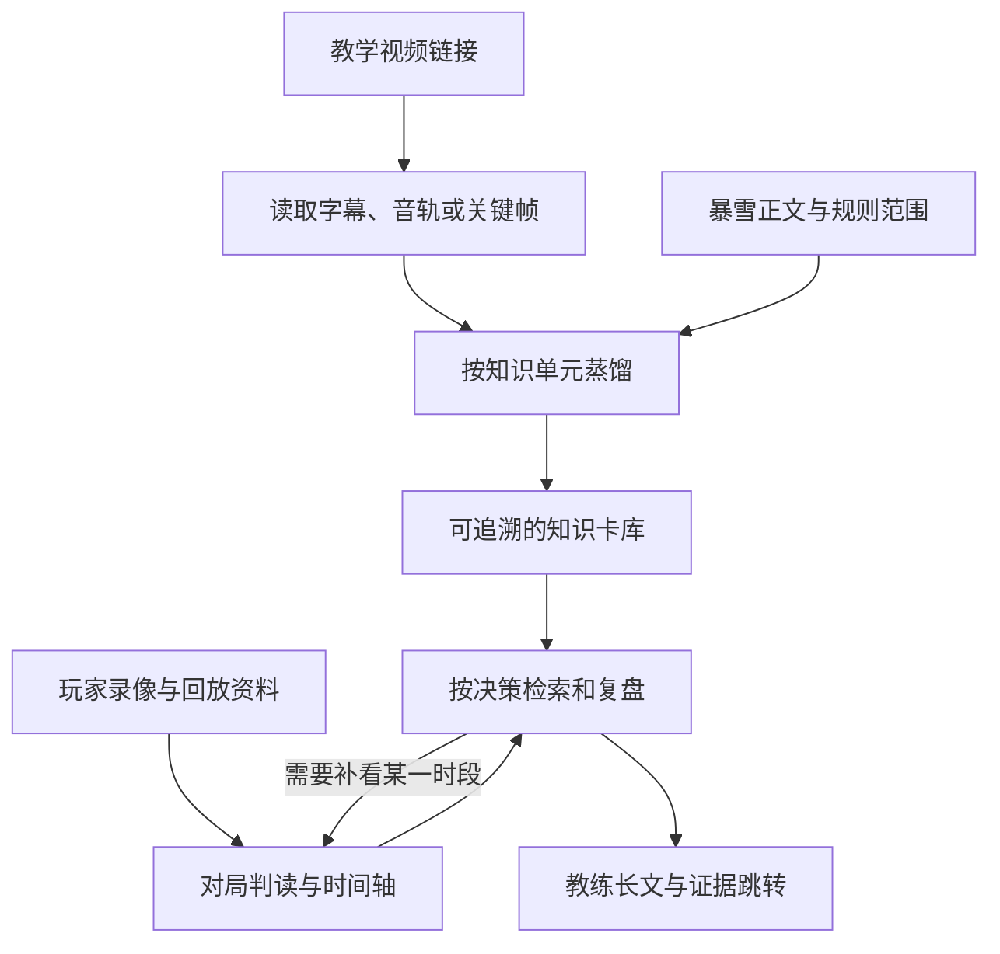

# overwatch-guide 全栈 Agent 改造方案

2026 年 11 月 17 日 · 基于本次上传的 `overwatch-guide.zip`、三个项目 skill 和源码中的教练回答规范

玩家有两个入口。粘贴教学视频链接后，工作台提取讲解中的决策规则，按知识单元生成带出处的卡片。导入自己的对局后，视觉模型先还原比赛，再由复盘模型针对每个决策检索适用的卡，最后按现有规范写成教练长文。玩家能从一句点评分别跳回**本局发生操作的位置**和**教练讲到这条规则的位置**。

首版沿用浏览器 ES 模块、IndexedDB、Node 本机服务和托管 Worker。后端负责读取教学素材、调用外部模型和校验结果。浏览器继续保管玩家录像、知识库和复盘进度。先用一段教学和国王大道的一次决策做通这两个入口，再扩展到整场比赛。

## 1. 从上传的源码改哪里

已在上传包的独立副本运行 `npm test`，43 项通过。教学蒸馏包的 18 项校验器测试也已通过。这些是改造前的基线。下表区分已有能力和需要改变的行为。

| 入口或模块 | 上传包里的实际行为 | 改造落点 |
| --- | --- | --- |
| 教学导入 · `public/library.mjs`、`server/fetch-source.mjs`、`server/model.mjs` | 已能收链接、抓网页正文、分段提炼和勾选入库。链接流程要求先选一个分类，每次蒸馏返回一张卡。字幕清理会移除 SRT 时间行。 | 把网页元数据、字幕、音轨、关键帧分开读取。保留字幕定位，按决策单元返回多张卡，每张独立分类。 |
| 资料库 · `shared/knowledge.json`、`scripts/generate-version-cards.mjs` | 实数为 132 条，含 39 个观摩索引、13 条教练笔记、80 条标作“官方机制”的资料。按主分类统计，其中 79 条为“版本”。生成脚本含手写摘要和官网入口。 | 导入原 ID、作者和链接。索引用于找课，教练观点回溯到实际讲解，版本事实补对应的官方正文、章节和规则范围。两种分类维度分别保留。 |
| 录像判读 · `public/review.mjs`、`shared/domain.mjs` | 至多取五个代表时刻辨认身份和阵容，等玩家确认后继续。`normalizeRosters` 会从敌方删除与己方同名的英雄，换人只留英雄名。 | 记分板、切视角、换边和交战触发复看。按玩家、队伍、回合和时段记录阵容，允许镜像英雄。识别后自动继续，玩家可在时间轴纠正。 |
| 逐波建议 · `reviewWindow`、`selectNotesForWave`、`reviewWave` | 观察窗口已经收到教学卡，同时生成观察和建议。未选资料时，当前 132 条资料经 `knowledgePool` 只返回 79 条版本资料。逐波检索又优先从预选的小集合取卡。 | 判读阶段只读比赛材料。逐个决策从允许使用的完整卡库检索，再把命中的原文、条件和来源交给复盘模型。 |
| 成文与播放 · `shared/coach-skill.mjs`、`writeCoachReview`、`public/match.mjs` | 已有两段式教练长文。成文入口截取前 80 个观察点、20 波和 6 组归纳，正文中的时间文本统一跳本局。README 提到的报告 Markdown 下载在上传包页面中没有对应入口。 | 先形成带依据的逐波记录，再按回合写长文。时间链接按类型渲染，页面和 Markdown 导出共用一份报告。 |

现有测试还把“敌方名单排除己方英雄”“导入时先选分类”“清除 SRT 时间行”作为预期行为。旧接口继续跑兼容测试，新接口分别验收镜像英雄、逐卡自动分类和字幕时码往返。

## 2. 三个 skill 在程序里如何接力

| 规范 | 宿主交给模型的材料 | 可以交给下一步的产物 |
| --- | --- | --- |
| `overwatch-knowledge-distiller` 1.0.0 | 实际读到的课程片段、带行号或时间的字幕、目标规则范围，以及核验过的官方段落 | 遵循 `assets/bundle.schema.json` 的知识包。包含来源、证据、卡片、待核验单元和版本依赖。 |
| `overwatch-read-match` · 项目提交 `68898d0` | 指定玩家和区间、按播放器时轴定位的画面、可用音轨、玩家补充与回放元数据 | 采用 `references/handoff.md` 的对局记录。保留 `source`、`player`、`rounds`、`lineups`、`swaps`、`evidence`、`fights`、`playstyle`。 |
| `overwatch-kb-review` · 项目提交 `a129767` | 上述对局记录、决策前后证据、检索命中的卡片修订和原始出处 | 每个决策的触发信号、实际动作与结果、值得保留的操作、可行的下一手、依据、下一局训练项目。 |
| 已有教练回答规范 `COACH_SKILL` | 已完成的决策点评、双方分时阵容、目标和训练项目 | 沿用 `title / sections / closing` 对外成文。第一部分写本局该如何打，第二部分按录像时段展开。 |

在构建阶段收录前三份 skill 正文、各阶段需要的引用文件及机器契约，生成 Node 与 Worker 可共同导入的静态清单。`scripts/build.mjs` 将资源及生成好的清单纳入下载包，使解压后仍可直接执行 `npm start`。应用按阶段装入相应说明，调用现有模型客户端，再用宿主校验产物。教练规范继续以 `shared/coach-skill.mjs` 为唯一维护位置。每次运行记录实际使用的技能文件 SHA-256、契约版本和模型配置。知识库复盘 skill 自带 12 张独立运行用的起始卡，12 个 ID 均已包含在上传包的 132 条资料中。应用使用当前项目库和玩家自建卡，避免把旧快照重复导入。

## 3. 教学视频链接怎样变成可用的卡

1. **读取来源。** 首先接入项目实际使用的 B 站课程，解析普通链接、短链和分 P。保留原链接，以视频标识与分 P 区分课程。解析结果列出实际取得的通道和已读范围。可读字幕保存为带起止秒的原始 cue，并另存规范化文本。可取得音频时补带时间的转写。涉及落点、血量、屏障方向等视觉信息时，取相应区间的画面。只有标题和简介时创建“待补素材”记录，页面可直接追加字幕、视频或音频并续跑。
2. **按决策拆分。** 以讲解中的“谁在什么条件下要怎么做”划分知识单元。单元跨字幕块时保留上下文和原始 cue ID。同一节课若分别讲温斯顿的落点、安娜的支援视线和全队集火，生成重装、辅助、综合三类卡。仅仅出现在温斯顿准星里的安娜，记入温斯顿卡的对位条件。
3. **逐条落证。** 教学卡保留适用条件、可见信号、动作、理由、例外和复盘检查点。每条核心陈述的 `basis` 取 `source_statement`、`observed_event`、`official_fact` 或 `model_inference`，并指向原证据。引文按原字幕匹配，无可靠秒数时定位到行号或段落。界面允许并排查看原字幕、校正文本和卡片。
4. **核对版本。** 四个教学主类为 `tank / damage / support / general`，第五类 `version` 存放官方事实。涉及英雄、威能、地图或数值时，记录补丁生效日期、地区、环境、模式、平台和核验时间。教学卡通过 `version.depends_on_cards` 引用版本卡。解释旧录像时采用录制时适用的规则，为当前版本给练习时另标核验日期。之后的改动只触发相关卡片复核。
5. **入库与更新。** 自动保存来源和卡片。核心讲解经证据核对、结构和语义校验通过后标记 `ready`，关键结论出自模型推论或仍有冲突的卡标记 `needs_review`。检索时另外判断目标版本适用性。重复导入用“来源及分 P＋证据位置＋决策与条件”定位已有卡。同一课程允许多张卡，同一规则有新证据时追加证据和修订。教练偏好用于安排读课顺序，本项目优先人上人老王，再补 Guxue 等指定资料。

**一条可以立即试接的来源**是旧库的 `wang-winston-class` 与 `wang-winston-replay`。两项指向同一期课程的第 2 分 P。解析器只需读取该分 P 一次，两条旧索引都可以关联这份来源。卡里的新规则和时间戳由实际读取结果决定。这一期适合验收“同源去重，同时保留多项知识”。[原课程链接](https://www.bilibili.com/video/BV1Td4y1w7qM/?p=2)

## 4. 怎样从对局事实得到教练判断

**先判读比赛。** 复用浏览器播放器和现有每批最多八帧的传输。先粗看用户选择的区间，标出选人、记分板、换人、换边、交战与目标转换，再在关键选择前后加密抽样。技能较难看清时截取原分辨率 HUD 区域。模型返回已发帧 ID 或帧间边界，宿主映射到媒体时间。可变帧率素材优先记录实际展示时刻，无法精确定位的动作用区间表达。局内倒计时另存。回放码沿用现有 MCP 接口，返回地图或英雄时先展示元数据，关联录屏后补动作。

**把阵容绑定到玩家。** 先用姓名、记分板和 HUD 认出被复盘者，再区分其队伍与观战方。每次快照属于一个回合和时段。换人记录 `team / from / to / last_old_s / first_new_s`，可识别时再绑定玩家。看不清的栏位保留未知。镜像对局分队记录，人数按本局模式处理。控制、推进等对称模式记录控点方、回夺方或推行方向，固定攻防图在换边后重读。分别给出双方打法与支持该判断的团战。一个人转高台可归为个人施压，队友同步向同一目标进场才能归为协同切入。

**根据决策前的信息检索。** 浏览器从完整的可用卡库按“玩家英雄及别名、地图区域、回合目标、动作、敌方威胁、己方能否跟进”构造查询。先检查卡状态、适用范围和版本依赖，再匹配触发条件、例外和退出条件。精确检索不足时，扩大到同英雄的通用卡、同职责卡和综合卡，地图专属规则仍限该图。默认自动检索教学卡及必要的版本依据。玩家明确限定资料集时保留该范围。观摩索引可出现在“延伸观看”。未经核验的时效性内容保留为候选。

**由复盘模型给可执行的下一手。** 每条决策记录包含 `fight_id`、决策前证据、实际动作、事后结果、替代动作及其可行条件。新卡以 `card_id + revision + claim_id` 定位原则，旧笔记以真实 ID、原字段和内容快照定位。模型可请求回看某个短区间，由浏览器在本次采样预算内补取，复用已取过的帧。无匹配卡时，普通复盘允许标注“画面判断”。玩家选择“仅按知识库”时，该行呈现观察和缺失的教学依据。结果中保留实际采用的卡片及证据快照，编辑或隐藏知识卡后旧报告仍能回溯。

**再写给玩家。** 首段写明阵容和目标，把最值得先练的决策连同本局时码写进该段。后续每一阶段讲实际动作、做得好的地方、收益与代价、下一次看见什么信号该怎么做。末尾给可计数的练习，以实际可行机会为分母。保留现有中文教练口吻，时码、英雄名、摘录、数值及出处由结构化字段渲染。正文沿用 `mm:ss`，点击后播放器按证据的实际秒数定位。超长对局按回合分组或分页，所有波次都能从时间轴打开。无有效动作时直接返回素材覆盖报告，跳过长文调用。

## 5. 前后端接口与数据归属

以下接口名为改造提案。新数据结构走 `/api/v2`，旧复盘记录和旧客户端继续由原接口读取。录像、卡库和复盘进度保存在当前浏览器。

| 拟设公开接口 | 请求和返回 | 接到现有代码的位置 |
| --- | --- | --- |
| `POST /api/v2/teaching/sources`、`GET /api/v2/teaching/sources/{id}` | 提交课程 URL、分 P 和区间，补字幕或媒体引用时带上原来源 ID。短任务直接返回带定位的素材页，耗时任务返回作业 ID，供查询状态、已读范围、分页证据或缺少的材料。 | 扩展 `fetch-source.mjs` 和 `server/api.mjs` 的路由。知识库页展示读取进度、片段与重试入口。 |
| `POST /api/v2/knowledge/distill` | 输入素材页、目标范围和批次标识。处理批次返回候选单元，合并阶段返回完整知识包，同包保留所引用的版本卡与证据。 | 在现有 `distill` 的模型调用处加载蒸馏 skill。以原包 Schema 为准，JS 做运行时校验，CI 用原包 Python 校验器交叉验证。任务游标存在外层。 |
| `POST /api/v2/match/read` | 以选定片段、玩家线索、带 ID 的帧批执行观察，或用已验证的窗口事实汇总回合。返回增量证据、需复看的区间或统一交接记录。 | `public/review.mjs` 管抽帧、补帧和断点。`identifyMatch / identifyRosters` 的辨认能力并入判读阶段。 |
| `POST /api/v2/review/fight` | 输入本波事实、决策前后证据和候选卡修订，返回逐条点评、使用的陈述、可行条件及训练候选。 | 由 `shared/domain.mjs` 的检索逻辑生成候选集。逐波模型处理替代动作与教学判断。 |
| `POST /api/v2/review/coach` | 输入已完成的逐波记录及分时阵容。返回兼容旧长文的章节，并让每章携带可解析的决策 ID 和引用。 | 保留 `writeCoachReview` 与 `COACH_SKILL`。报告页以同一结果渲染正文、逐波证据和 Markdown。 |

**模型调用的约定。** 服务端把相应 skill 指令作为固定消息，字幕、画面、用户关注点和候选卡各自作为带来源的输入。读比赛时不传教学卡，逐波点评只传该波所需的事实和候选陈述。程序核对返回的帧 ID 属于本批、本局证据属于本波、引用的卡与陈述属于本次候选修订。越界引用回到当前步骤修复，不能落到默认第一帧。`review/fight` 如返回 `needs_frames`，浏览器补帧给 `match/read` 更新证据，再继续该波。上传的大段课程音视频走媒体处理通道，JSON 接口只传素材引用、分页文本或限定帧批。

**两种时间定位。** 本局引用保存 `match_id / clip_id / evidence_id / start_s / end_s`。教学引用保存 `bundle_id / card_id / revision / claim_id`，再沿证据找到原课的 `source_id`、时段或文本位置。这样两份材料都叫 `E1`、时间都显示 01:20 时，点击仍会打开各自的素材。导入时保留包内原 ID，由工作台分配包 ID 和跨包合并关系。

**前端。** 教学页把“课程链接”放在首位，分类下拉改为结果筛选，呈现素材覆盖、按类卡数、原片或原字幕定位。对局页在播放器下增加回合、阵容变化和团战时间轴，允许直接纠正某段的英雄、阵营和视角。报告的“本局录像”跳当前播放器，“教学依据”打开原课时段或文本位置，“版本依据”打开官方段落。旧页面的 `linkTimes()` 只适合单时间轴，改用类型化引用。

**模型与部署。** 外部模型客户端复用现有 `ask`、JSON 解析、请求体限额和服务商预设。设置页可分别指定视觉和文本模型，也可共用一个多模态端点。课程有字幕时直接蒸馏，缺字幕且音轨可用时调用转写。模型目录用于选型，视觉与转写能力用对应输入实测。Node 可接本机媒体处理进程，托管 Worker 通过同一接口把耗时的取流、抽音轨和转写交给媒体作业服务。素材获取服务持有作业状态和临时媒体，按来源分段返回结果。新增状态分别公布字幕、音频转写和视觉能力，现有 `sourceDownload` 标志用于源码下载。课程抓取校验平台与跳转目标并设置读取上限。自定义模型和回放端点沿用各自设置，API Key 继续按会话或服务端环境传入。[URL 抓取实现参考](https://cheatsheetseries.owasp.org/cheatsheets/Server_Side_Request_Forgery_Prevention_Cheat_Sheet.html)

**存储与恢复。** 在 IndexedDB v3 上增量升级，用新的对象仓库保存教学来源、证据、卡片修订和任务检查点。原录像继续由 `videos` 保存，保留 `matches / shelf / cards / hidden` 的旧读取路径。浏览器通过 Web Locks 锁住同一任务，每段产物与游标在同一事务内写入。教学作业用来源、分 P 和内容修订去重。比赛判读的缓存键包含素材指纹、时段、采样、玩家线索、视觉模型和判读 skill 版本。知识库变化后重新做本地检索，逐波缓存比对事实修订、候选卡修订、筛选范围、文本模型与复盘 skill 版本，成文另记教练规范版本。纠正阵容时更新相关波次及摘要，修改知识卡时可直接复用视觉结果。关闭页面、模型限流或重试时，从最后已提交的阶段继续。

**兼容旧资料。** 给 132 条内置资料和用户卡保留原 ID、原文、隐藏状态和出处。已有教练笔记按“项目笔记＋原卡标题和已有来源”直接参与复盘，能定位到作者原话的部分可作引文。若原卡只能定位到整页，界面就给页面入口。对标作官方机制的条目按段核验，再拆成版本事实和战术建议。旧的 `knowledge-pack.json` 保留导入适配，新导出使用带来源、证据和修订的完整 bundle。历史报告按原格式打开。处理中旧任务继续走旧路径，主动重新分析时开新任务。旧的选卡记录仍显示为该次使用的资料范围。

## 6. 国王大道温斯顿的验收样例

《守望先锋坦克教学》的历史复盘记录了**国王大道、混合图、己方进攻 A 点**。旧点评给出的己方是温斯顿、源氏、黑百合（后换卡西迪）、安娜、雾子，敌方是西格玛、死神、西拉、巴蒂斯特、朱诺。换人时间可先给区间。回放画面顶部显示“防守目标点 A”，这个例子可以检验系统是否先绑定玩家及队伍，再解释观战 HUD。

| 录像时段 | 用这段检验什么 | 合格的报告应怎样写 |
| --- | --- | --- |
| 00:08、00:16 | 雕像首跳与转二楼分开记录 | 用现有笔记 `winston-kings-row` 对比有掩体的步行路线和雕像落点，再用 `spilo-tank-engage` 核对上二楼时谁能一起开火。`wang-winston-replay` 留作原课观摩入口。 |
| 00:44–00:47 | 追残血西拉时，屏障要处理哪个方向的控制 | 保留抓残血的合理动机。对照罩子状态、敌人起手及相对位置后，再讲能否在控制命中前放罩。 |
| 01:07–01:20、01:43 | 二楼处理西拉、施压双辅和处理维生力场，与之后跳向被睡的巴蒂斯特是不同选择 | 区分英雄击杀、装置摧毁和占点进展。点评清掉高台威胁后还能保留哪条压力线，以及下一跳的跟进和退出条件。 |
| **01:49.500–01:53** | **检验决策时能知道什么。** 前一张留存帧上，温斯顿为 625/625，原始暴怒 92%，画面出现西格玛开大语音字幕。后一张为 0/625、94%。 | 两个读数分别绑定本局帧。回到抬升前核对喷射背包、控制生效时刻和范围外落点。建议应能在该时刻执行。 |
| 约 02:15 | 旧点评记载己方拿下 A 点 | 将其写为本段团队的目标结果。该次个人阵亡与全队占点分别记录。 |

**有教学笔记时。** “00:08 先看雕像。走到背侧这段路如果有掩体，队友也还没绕过拱门，就可以把跳留给二楼。再停在 00:16，看你上去的时候谁已经能打到同一区域。这两次落点要分开算。” 此处引用项目已有的《国王大道 A 点的第一处落位》和《等队友能出手再压进去》，按原卡已有精度链接文章或课程。[17173 地图教学](https://ow.17173.com/content/07232025/165721278.shtml) · [Spilo 教学](https://www.youtube.com/watch?v=1CrDa2pkKjA)

**只有本局证据时。** “**01:49**，画面已经给出西格玛的开大提示，你的原始暴怒是 92%。暂停看这时的喷射背包，再找一个能跳出范围的落点。如果起跳窗口还在，这一跳就用来撤。到 **01:53** 你已经阵亡，大招才到 94%。下一局看同类场面，只统计看到或听到起手、还能跳、范围外有落点的机会。” 两个实际读数取自项目留存帧，撤离窗口交由前后连续帧判定。这条建议标作“画面判断”。[本局 01:49.500 帧](https://chatgpt.com/library?file_id=libfile_167e5aeef2b08191b3bc5c7d2ed642fb&account_id=personal) · [本局 01:53 帧](https://chatgpt.com/library?file_id=libfile_d377fa7c6d6081918fbfd6c20c33e9ba&account_id=personal)

## 7. 可独立交付的开发顺序

每一步都从用户入口走到可验证结果。测试重点放在公开 API、浏览器交互和实际产物，外部媒体与模型可用固定响应做回归。另用可读原课、真实对局和配置好的服务商跑端到端验收。[Matt Pocock · 纵向拆分](https://github.com/aurorasoft2/Matt_Pocock_Skills/blob/main/skills/engineering/to-issues/SKILL.md) · [Matt Pocock · TDD](https://github.com/aurorasoft2/Matt_Pocock_Skills/blob/main/skills/engineering/tdd/SKILL.md)

| 顺序 | 交付给玩家的结果 | 验收条件 |
| --- | --- | --- |
| 1 · 链接成卡 | 一条有字幕的真实课程链接，自动出现带定位的卡。 | 用讲到两项独立决策的材料。两张卡可落入不同主类，各自跳到原句。重复导入不新增重复卡，仅有简介时显示待补材料。 |
| 2 · 单波判读 | 打开国王大道片段，先看到可纠正的对局时间轴。 | 以玩家为参照判定进攻，正确保留 92% 和 94% 的时序。另用镜像对局、换人、换边和观战切镜夹具检查归属。未知项可继续通过流程。 |
| 3 · 双来源复盘 | 将第 1 步的适用卡和第 2 步的一次决策接起来，生成第一份两段式教练报告。 | 点击本局定位回放，点击教学依据打开原课或段落。来源不匹配时走相应的无卡分支。更新原卡后重开旧报告，仍指向当次修订。 |
| 4 · 全场与恢复 | 完成整场逐波报告、Markdown 导出和旧库升级。 | 末波可达，空片段可结束。分别在识别、检索后和成文时中断，继续后无重复记录。两个标签页只提交一份任务。旧报告、隐藏卡和已选资料范围可读。 |
| 5 · 完整教学接入与发布 | 加入可取音轨课程的转写、官方版本复核以及托管媒体处理。 | 同课分 P 独立定位。版本变化只标记受影响陈述。Node 与 Worker 使用同一套 skill 内容并产出同构结果。用一段真实课程和一段真实录像验证配置好的外部服务。 |

**发布验收。** 结构项可自动核对，所有被引用的比赛证据、教学陈述和卡片修订都应能解析，引用时间落在实际覆盖区间，正式库排除演示卡。比赛理解用逐帧标注的小样复核，分别报告已判字段的正确率、字段覆盖率、换人时间边界和团战归属。教练逐项核对建议在当时能否执行、命中的卡是否适用，以及玩家能否在下一次同类机会里验证。首次联调以第 3 步通过为里程碑。

**项目依据。** 源码以本次上传包为准。前后端取舍延续 IdeaMiner 的本地优先与来源可追溯思路，工程拆分采用 Matt Pocock 的模块审查和公开行为测试方法。[上传的源码](https://chatgpt.com/library?file_id=libfile_4405c96697788191834c8f4426bc6708&account_id=personal) · [蒸馏 skill 与机器契约](https://chatgpt.com/library?file_id=libfile_04cabd98facc8191abbb3f99c5cec973&account_id=personal) · [IdeaMiner](https://github.com/dykuang/idea-manager) · [工程模块审查](https://github.com/aurorasoft2/Matt_Pocock_Skills/blob/main/skills/engineering/improve-codebase-architecture/SKILL.md)
